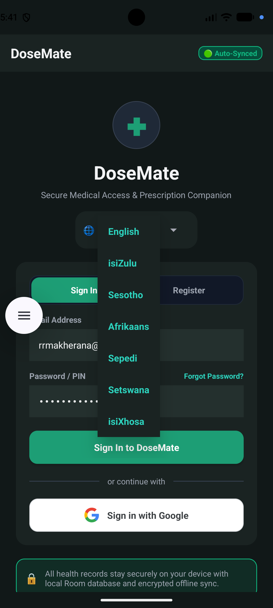
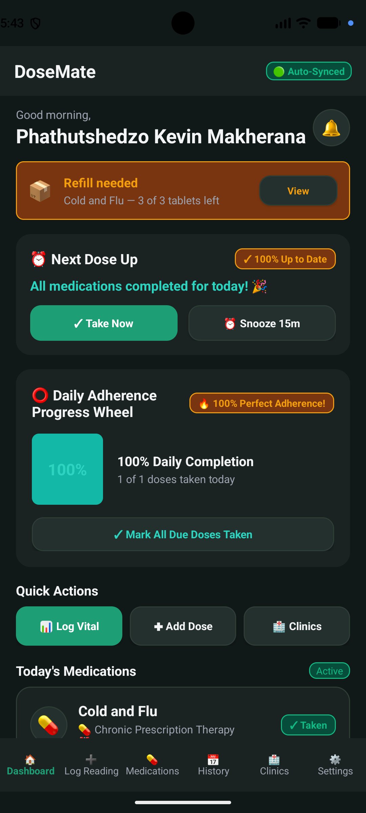
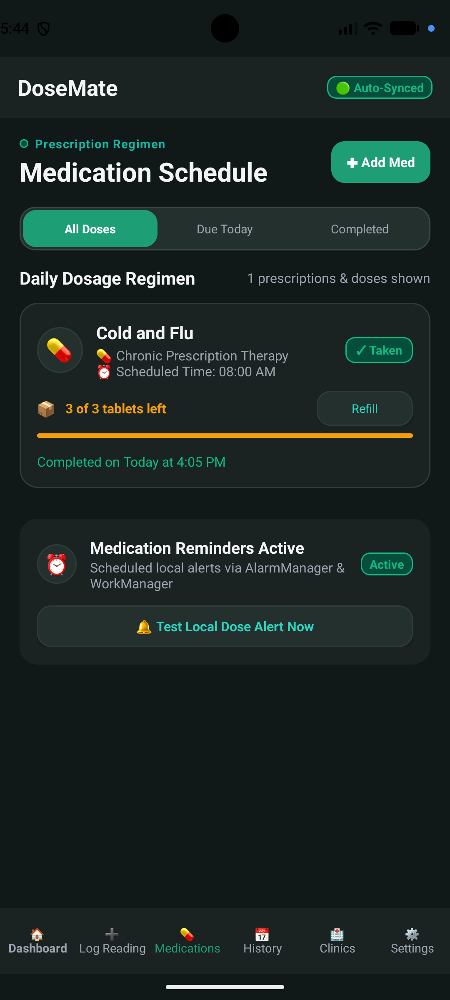
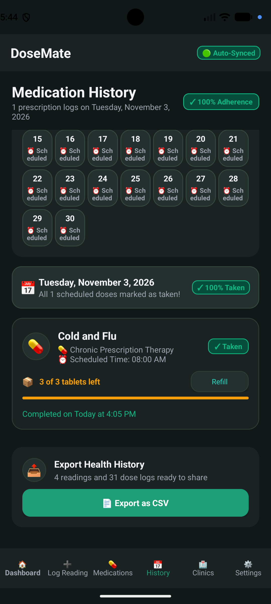
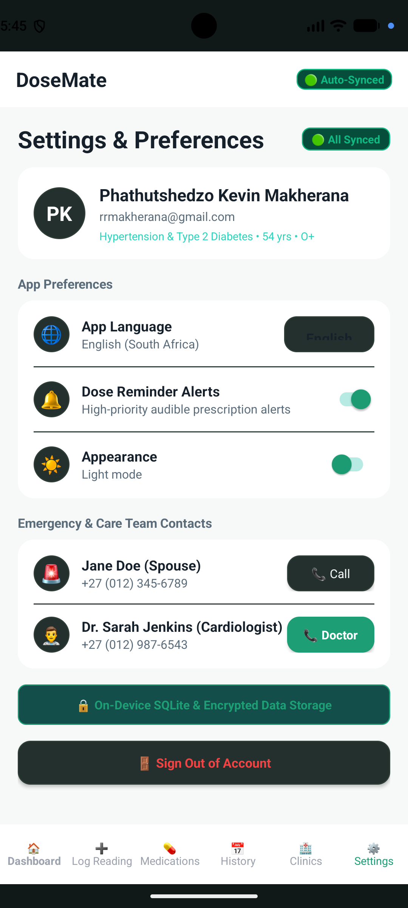
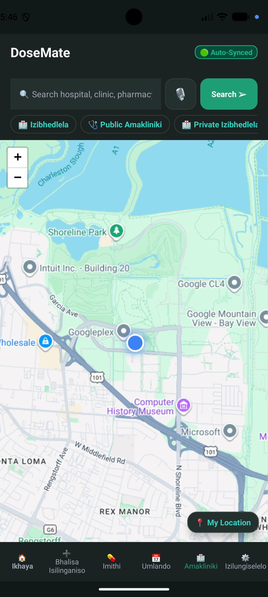

# DoseMate 🩺

**DoseMate** is a medication management and health tracking app for Android, built for adults living with a long-term condition such as diabetes or hypertension. It keeps track of prescription schedules, fires high-priority dose reminders, records blood sugar and blood pressure readings, tracks how many tablets are left in a pack, and works offline with automatic sync once a connection returns.

Built entirely in **Kotlin with XML layouts**.

| Platform | Language | UI | Min SDK | Target SDK |
|---|---|---|---|---|
| Android | Kotlin | XML layouts | 26 | 37 |

---

## 📸 Screenshots

| Sign in | Dashboard | Medications |
|---|---|---|
|  |  |  |

| History & export | Light mode | isiZulu |
|---|---|---|
|  |  |  |

---

## 🎥 Demo Video

A full walkthrough of the app with voice-over narration:

**[Watch the DoseMate demo](INSERT_YOUTUBE_LINK_HERE)**

---

## 🌟 Features

### Medication schedule and reminders
Prescriptions can be scheduled once, twice, three or four times a day, with an individual time picker for every dose. Reminders fire through `AlarmManager.setAlarmClock(...)` with `NotificationCompat.PRIORITY_MAX`, so the alert appears as a heads-up banner with sound and vibration whether the app is open, backgrounded or closed.

### Refill tracking
When a medication is added, the patient can record how many tablets are in the pack. Each dose marked as taken removes one tablet from the count. The medication card shows the remaining tablets with a progress bar, a Refill button appears once stock runs low, and the dashboard displays a warning banner so a repeat prescription is never forgotten.

### Health history export
The complete health record — readings, medication adherence and an adherence summary — can be exported to a CSV file and shared through the Android share sheet, so it can be emailed to a doctor or opened in a spreadsheet before a clinic visit. The file is written to the app's private cache and shared through `FileProvider`, so no storage permission is required.

### Interactive calendar history
A custom seven-column monthly calendar marks each date by adherence status: green when every dose was taken, amber when doses were missed, and neutral when nothing was scheduled. Tapping a date shows the exact dose logs for that day.

### AI medication assistant
A conversational assistant powered by the Google Gemini API answers questions about side effects, drug interactions, missed doses and general wellbeing, with quick-inquiry chips for common questions.

### Clinic locator
An embedded Leaflet map with MapTiler tiles and geocoding finds nearby clinics, hospitals and pharmacies, with live GPS tracking and routing to the chosen facility.

### Offline-first storage with sync
Every medication, dose log and health reading is written to a local Room (SQLite) database first, so the app works with no connection. A `NetworkConnectivityMonitor` and an `AutoSyncWorker` background job push pending records to Firebase Cloud Firestore as soon as connectivity returns, and the header badge shows the current sync state.

### Light and dark mode
An Appearance toggle in Settings switches the whole interface between light and dark. The choice is stored against the user profile in Room, so it survives a restart.

### Multi-language support
The interface is available in **English, Afrikaans, isiZulu, Sesotho, Sepedi, Setswana and isiXhosa**, selectable at sign-in and in Settings.

---

## 🛠️ Tech Stack

| Layer | Technology |
|---|---|
| Language | Kotlin |
| UI | XML layouts, Material Components, ViewBinding |
| Architecture | MVVM with `ViewModel`, `StateFlow` and Kotlin Coroutines |
| Local database | Room over SQLite (`HealthBridgeDatabase`, schema v5) |
| Cloud database | Firebase Cloud Firestore |
| Authentication | Firebase Auth with Google Sign-In via Credential Manager |
| Background work | WorkManager (`AutoSyncWorker`), AlarmManager |
| Notifications | `NotificationCompat` heads-up banners |
| Networking | OkHttp, Retrofit, Moshi |
| AI | Google Gemini API |
| Maps | Leaflet.js with MapTiler tiles, geocoding and routing |
| Drug data | OpenFDA API |
| Testing | JUnit, Robolectric |
| CI | GitHub Actions |

All external services are hosted and remotely accessible. The app has no localhost dependency.

---

## 📱 Screens

| # | Screen | Layout | Purpose |
|---|---|---|---|
| 1 | Sign in and Register | `fragment_auth.xml` | Email and password or Google Sign-In, language selector, password reset |
| 2 | Dashboard | `fragment_dashboard.xml` | Next dose countdown, adherence ring, refill warning, quick actions |
| 3 | AI Assistant | `fragment_log_reading.xml` | Gemini-powered medication chat with quick-inquiry chips |
| 4 | Medications | `fragment_medications.xml` | Prescription list with refill counts, filters, add-medication dialog |
| 5 | History | `fragment_health_history.xml` | Monthly adherence calendar and CSV export |
| 6 | Clinic Locator | `fragment_clinic_locator.xml` | Map search, GPS tracking and routing to facilities |
| 7 | Settings | `fragment_settings.xml` | Profile, language, appearance, reminders, emergency contacts |

---

## 🗂️ Project Structure

```
app/src/main/java/com/example/
├── data/                     Room entities, DAOs, repository, API clients
├── notifications/            AlarmManager scheduling and notification helpers
├── ui/
│   ├── adapters/             RecyclerView adapters
│   ├── MainViewModel.kt      Shared state for every screen
│   └── XmlUiController.kt    Inflates and wires each XML screen
├── util/
│   ├── HealthDataExporter.kt CSV export and share sheet
│   └── Strings.kt            Runtime translation helper
├── MainActivity.kt
└── DoseMateApplication.kt

app/src/main/res/layout/      One XML layout per screen, plus dialogs and list items
app/src/test/                 Unit tests
.github/workflows/android.yml CI pipeline
```

---

## 🧪 Testing

Unit tests live in `app/src/test/java/com/example/`. `DoseMateFeatureTest` covers the two features added in Part 3, with each test asserting both a valid and an invalid case:

| Test | Valid case | Invalid / edge case |
|---|---|---|
| `refillThreshold_flagsOnlyWhenStockIsLow` | 3 tablets against a threshold of 5 is flagged | 20 tablets is not flagged |
| `pillCount_decrementsButNeverGoesNegative` | 10 tablets becomes 9 | An empty pack stays at 0, not -1 |
| `csvExport_escapesCommasInNotes` | A plain note is written unquoted | A note containing a comma is quoted |
| `csvExport_calculatesAdherencePercentage` | Two of four doses reports 50% | An empty log reports 0% without dividing by zero |
| `csvExport_alwaysIncludesBothSections` | Rows appear under both headers | Empty data still writes both headers with placeholders |

Run them locally with:

```bash
gradlew.bat testDebugUnitTest          # Windows
./gradlew testDebugUnitTest            # macOS or Linux
```

---

## ⚙️ Continuous Integration

The pipeline in `.github/workflows/android.yml` runs on every push and pull request to `main`, `master` and `develop`, in three stages:

1. **Environment setup** — JDK 17, Gradle caching, and generation of the `.env` file from repository secrets
2. **Unit test suite** — runs the Part 3 feature tests, then the full suite, uploads the HTML reports as an artifact, and publishes a results table parsed from the generated XML
3. **APK assembly** — builds the debug APK and uploads it as a downloadable artifact

---

## 🚀 Building and Running

```bash
# Clone the repository
git clone INSERT_GITHUB_REPO_LINK_HERE
cd DoseMate

# Build the debug APK
gradlew.bat assembleDebug          # Windows
./gradlew assembleDebug            # macOS or Linux
```

The APK is written to `app/build/outputs/apk/debug/app-debug.apk`.

To run from Android Studio, open the project, let Gradle sync, choose a device or emulator running API 26 or higher, and press Run.

**API keys.** The app reads its keys from a `.env` file in the project root, loaded by the Secrets Gradle Plugin. Copy `.env.example` to `.env` and fill in your own values. The map and AI features need valid keys; everything else, including the database, reminders, refill tracking and CSV export, works without them.

---

## 👥 Team

| Name | Student number |
|---|---|
| Phathutshedzo Kevin Makherana | st10438610 |
| Neo Madima | st10444163 |
| Mufhumudzi Rasilingwana | st10441516 |

**Module:** OPSC6312 · IIE Rosebank College, Pretoria

---

## 📄 License

Released under the MIT License.
